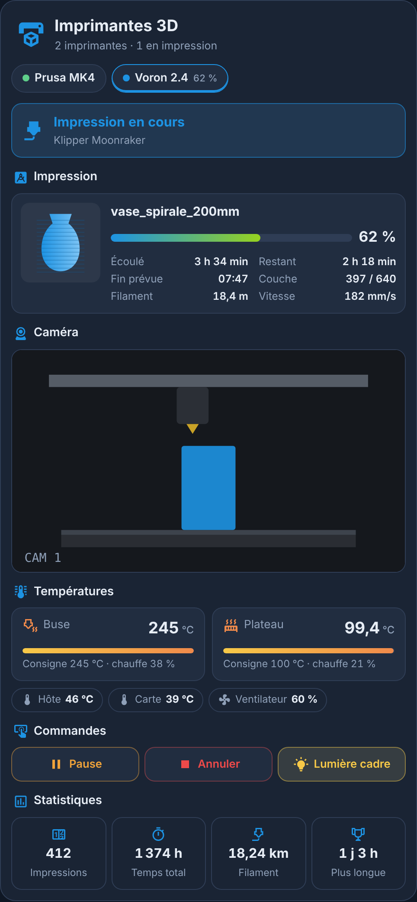
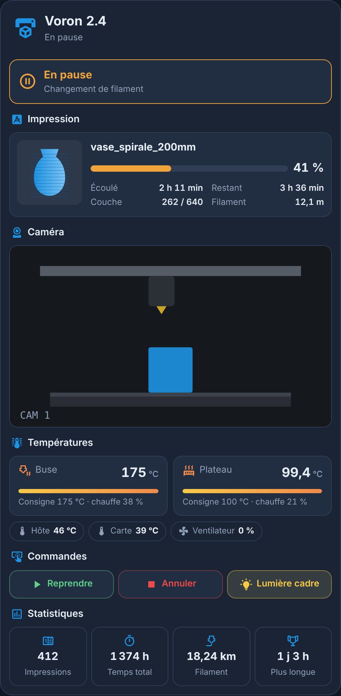
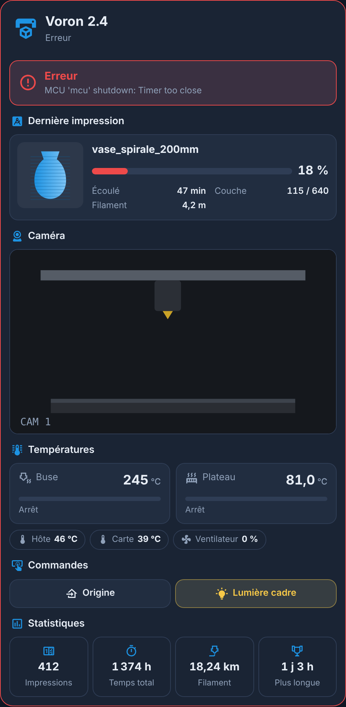
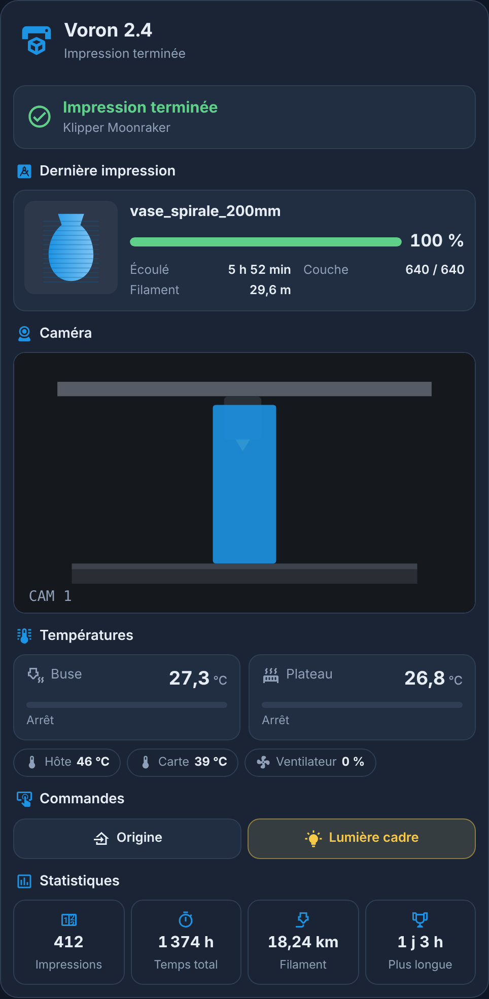
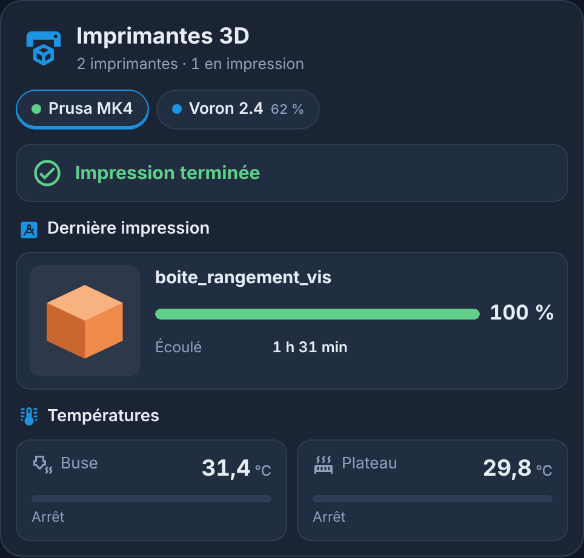
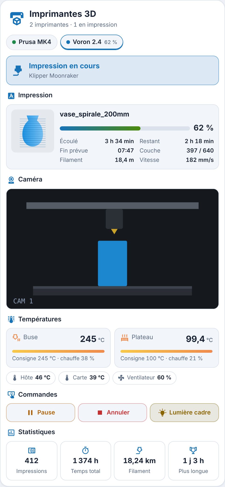

# Carte Imprimantes 3D

**Une carte Lovelace pour suivre vos imprimantes 3D dans Home Assistant** : état, impression en cours, caméra, températures, commandes et statistiques. Elle a le style des cartes MyElectricalData new ([Carte Enedis Linky New](https://github.com/Marlboro62/content-card-linky-new)) et des [Cartes Serveur HA](https://github.com/Marlboro62/serveur-ha-card) : thème bleu nuit, version claire, ou thème Home Assistant.

**Aucune dépendance** : pas de button-card ni de card-mod. Les imprimantes sont **détectées automatiquement**, une par onglet, et chaque élément sans capteur est simplement masqué.

| Impression en cours | En pause | Erreur |
| --- | --- | --- |
|  |  |  |

| Impression terminée | Seconde imprimante | Clair |
| --- | --- | --- |
|  |  |  |

*Aperçus réalisés avec la démo et des valeurs fictives (imprimantes, fichiers et images de caméra inventés).*

**[▶ Essayer la démo en ligne](https://marlboro62.github.io/printers/docs/demo.html)** : une ou deux imprimantes, en impression, en pause, terminée, en erreur, prête ou éteinte, en sombre ou clair, sur téléphone ou PC.

## Intégrations reconnues

| Intégration | Où la trouver | État |
| --- | --- | --- |
| **Moonraker** (Klipper : Voron, Creality K1 / Neo, Elegoo Neptune 4…) | HACS, [home-assistant-moonraker](https://github.com/marcolivierarsenault/moonraker-home-assistant) | testée |
| **OctoPrint** | intégrée à Home Assistant | prévue, non testée |
| **PrusaLink** (MK4, Mini, XL, Core One) | intégrée à Home Assistant | prévue, non testée |
| **Bambu Lab** | HACS, [ha-bambulab](https://github.com/greghesp/ha-bambulab) | prévue, non testée |

Si votre intégration n'est pas bien reconnue, ouvrez une [issue](https://github.com/Marlboro62/printers/issues) avec la liste des entités de l'imprimante.

## Installation

### Avec HACS (recommandé)

1. Dans HACS, menu **⋮** → **Dépôts personnalisés**.
2. Ajoutez `https://github.com/Marlboro62/printers` avec le type **Tableau de bord** (Dashboard).
3. Cherchez **Carte Imprimantes 3D**, installez, puis rechargez la page (Ctrl+F5).

> Tant qu'il n'existe qu'une version bêta, activez **Afficher les versions bêta** dans la fenêtre de téléchargement de HACS.

### Manuellement

1. Téléchargez [`printers-card.js`](https://raw.githubusercontent.com/Marlboro62/printers/main/printers-card.js) (clic droit → Enregistrer sous) et copiez-le dans `/config/www/`.
2. **Paramètres → Tableaux de bord → ⋮ → Ressources → Ajouter une ressource** : URL `/local/printers-card.js`, type **Module JavaScript**.
3. Rechargez la page (Ctrl+F5).

## Utilisation

```yaml
type: custom:printers-card
```

La carte a un **éditeur visuel**. Sans réglage, elle affiche toutes les imprimantes trouvées.

### Ce qu'elle affiche

- **Onglets** : une imprimante par onglet, avec un point de couleur (prête, en impression, en pause, en erreur) et l'avancement. L'onglet choisi est retenu ; sinon la carte ouvre l'imprimante en cours d'impression.
- **Imprimante déclarée deux fois** (Ethernet et Wi-Fi) : un seul onglet. La carte garde la connexion qui répond, et l'Ethernet si les deux répondent.
- **État** : prête, impression en cours, en pause, terminée, annulée, erreur, hors ligne, avec le message de l'imprimante (erreur Klipper, changement de filament…). La carte prend une bordure rouge en cas d'erreur.
- **Impression** : aperçu du fichier (miniature du trancheur), nom, barre de progression, temps écoulé et restant, heure de fin prévue, couche, filament utilisé, vitesse. Après l'impression : « Dernière impression ».
- **Caméra** : image rafraîchie toutes les 5 s (réglable), sans recharger la carte.
- **Températures** : buse, plateau et caisson, avec la consigne et la puissance de chauffe ; températures de l'hôte et de la carte mère, ventilateur.
- **Commandes** : pause, reprise, annulation, arrêt d'urgence, retour à l'origine et lumières. **Annuler, l'arrêt d'urgence et l'origine se confirment en deux clics** : le premier arme le bouton (coche orange qui pulse), le second dans les 5 secondes envoie la commande.
- **Statistiques** : nombre d'impressions, temps total, filament total, plus longue impression.

Un clic sur un élément ouvre la fiche de l'entité dans Home Assistant.

### Options

| Option | Rôle | Par défaut |
| --- | --- | --- |
| `title` | Titre de la carte | nom de l'imprimante, ou « Imprimantes 3D » |
| `icon`, `icon_color` | Icône et couleur de l'icône | `mdi:printer-3d`, bleu |
| `printers` | Imprimantes affichées, dans cet ordre : appareils, ou `{ device, name, camera }` | toutes |
| `camera` | Caméra à afficher, à la place de celle de l'imprimante | caméra de l'imprimante |
| `camera_refresh` | Rafraîchissement de la caméra (secondes, 2 au minimum) | `5` |
| `show_job`, `show_camera`, `show_temps`, `show_controls`, `show_stats` | Afficher chaque partie | `true` |
| `theme` | `v2` (bleu nuit MyElectricalData), `auto` (clair ou sombre selon Home Assistant) ou `ha` (thème Home Assistant) | `v2` |

Exemple avec deux imprimantes, un nom et une caméra choisis :

```yaml
type: custom:printers-card
printers:
  - device: 0123456789abcdef0123456789abcdef
    name: Atelier
    camera: camera.atelier_webcam
  - 89abcdef0123456789abcdef01234567
```

L'éditeur visuel remplit `printers` pour vous : choisissez les appareils dans la liste.

## Support

Questions et problèmes : uniquement via les [issues GitHub](https://github.com/Marlboro62/printers/issues).

## Voir aussi

[Cartes Serveur HA](https://github.com/Marlboro62/serveur-ha-card) · [Carte Onduleur UPS](https://github.com/Marlboro62/onduleur-ups-card) · [Carte Enedis Linky New](https://github.com/Marlboro62/content-card-linky-new)

Si la carte vous est utile : [Buy Me a Coffee](https://buymeacoffee.com/marlboro62) · [Ko-fi](https://ko-fi.com/nothing_one)

## Licence

MIT
